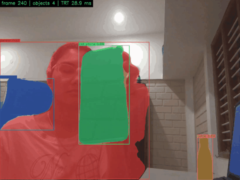
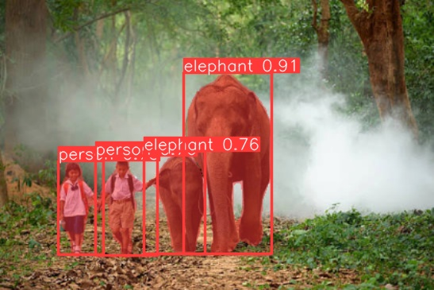
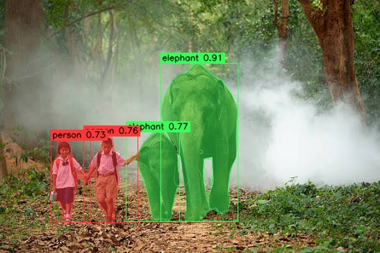
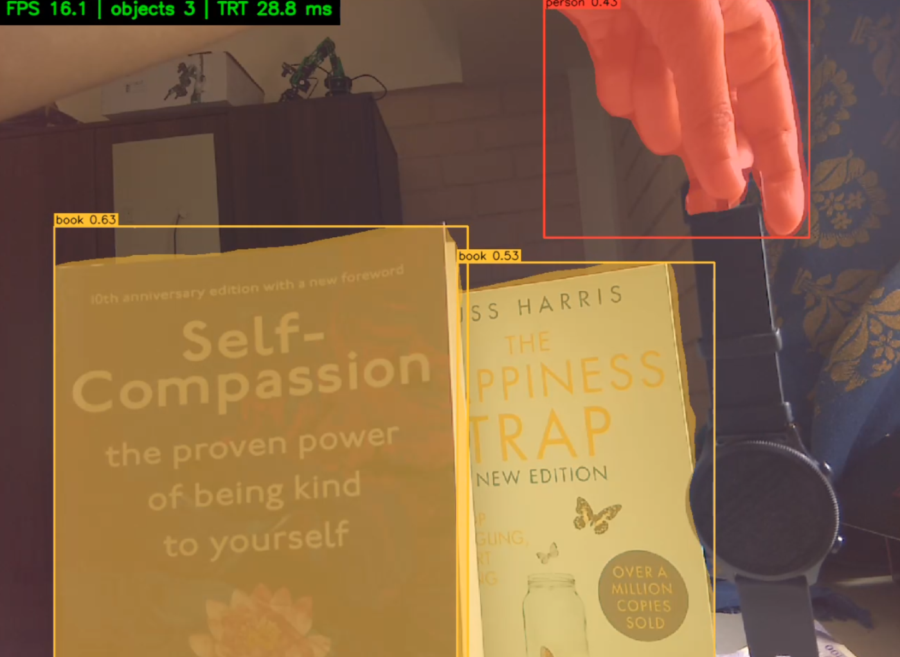

# Edge AI on Jetson Nano: YOLOv8n-seg with TensorRT

Real-time instance segmentation on a Jetson Nano: C++ TensorRT inference on the CSI camera, with a hardware H.264 stream to a laptop.
It is benchmarked for accuracy (COCO), latency, power and thermals.

<p align="center"></p>

## Setup

| | |
| --- | --- |
| Board | Jetson Nano 4 GB (P3448-0002 eMMC module, Waveshare carrier), headless over USB/SSH |
| Software | JetPack 4.6.6, TensorRT 8.2.1, CUDA 10.2, OpenCV 4.1.1, GStreamer |
| Camera | IMX219, sensor mode 3: 1640×1232 at 30 FPS (full field of view) |
| Model | YOLOv8n-seg, ONNX opset 12, input 320×416 (matches the 4:3 camera) |
| App | C++17: TensorRT `enqueueV2`, CUDA runtime, OpenCV, GStreamer |

```
CSI camera → capture → letterbox → TensorRT (FP16) → NMS + masks → draw → H.264 (NVENC) → RTP/UDP → laptop
```

## Repository

| Folder | Contents |
| --- | --- |
| [windows/](windows/README.md) | ONNX export, COCO subset, ONNX Runtime baseline |
| [jetson/](jetson/README.md) | C++ app, build/run scripts, profiling scripts |
| `scripts/` | Shared COCO metrics and comparison scripts |
| `results/` | All logs, metrics and images below |

## Results

### Accuracy

These numbers are on a 500-image COCO val2017 subset (seed 0), input 320×416, conf 0.001, NMS IoU 0.7. P and R are at conf 0.25, IoU 0.5.

| Run | Box mAP50 | Box mAP50-95 | Mask mAP50 | Mask mAP50-95 | Box P | Box R |
| --- | --- | --- | --- | --- | --- | --- |
| Windows ONNX Runtime FP32 (baseline) | 42.31 | 30.04 | 38.52 | 22.79 | 70.50 | 41.37 |
| Jetson TensorRT FP32 | 42.31 | 30.04 | 38.52 | 22.79 | 70.50 | 41.37 |
| Jetson TensorRT FP16 | 42.30 | 30.01 | 38.52 | 22.80 | 70.56 | 41.37 |

- **FP32 on the Jetson matches the Windows baseline exactly.** This shows the C++ pre-processing and post-processing match the reference.
- **FP16 changes mAP by 0.03 points or less**, so it loses no accuracy.
- **The official scores are higher at 640×640:** box 36.7 and mask 30.5 mAP50-95. The gap comes from the smaller input, chosen for speed.

Source: [`results/accuracy/comparison.csv`](results/accuracy/comparison.csv)

### Inference latency (TensorRT only)

Measured with trtexec over 60 s.

| Engine | Power mode | p50 (ms) | p99 (ms) | Throughput (FPS) |
| --- | --- | --- | --- | --- |
| FP32 | MAXN (10 W) | 32.8 | 32.9 | 30.5 |
| **FP16** | **MAXN (10 W)** | **25.5** | **25.6** | **39.2** |
| FP32 | 5 W | 46.1 | 46.2 | 21.7 |
| FP16 | 5 W | 36.0 | 36.0 | 27.8 |

FP16 is about 1.28× faster than FP32 in both power modes. The 5 W mode is about 1.4× slower than MAXN.

### Full pipeline, sustained over 5 minutes

The app loops the 1640×1232 demo video with masks on. The tegrastats figures exclude the first 60 s.

| Engine | Mode | FPS | Avg power | Energy per frame | Peak CPU / GPU temp | Peak RAM |
| --- | --- | --- | --- | --- | --- | --- |
| FP32 | MAXN | 12.4 | 6.02 W | 0.49 J | 52.0 / 50.5 °C | 2062 MB |
| **FP16** | **MAXN** | **13.7** | **5.49 W** | **0.40 J** | 45.0 / 43.0 °C | 2063 MB |
| FP32 | 5 W | 7.5 | 3.76 W | 0.50 J | 39.5 / 38.5 °C | 2053 MB |
| FP16 | 5 W | 8.1 | 3.63 W | 0.45 J | 46.0 / 44.5 °C | 2056 MB |

The runs showed no thermal throttling: FPS stayed flat for all 5 minutes. RAM stayed at about 2.06 GB of 4 GB.

### Per-stage latency (FP16, MAXN)

Each stage is an NVTX range, measured with Nsight Systems. The table lists the stages in the order they run within a frame.

| Stage | What it covers | Median (ms) | Share |
| --- | --- | --- | --- |
| `frame` | One whole loop iteration, containing all the stages below | 72.6 | 100% |
| `capture` | Read the next frame (camera via Argus, or hardware video decode) | 2.1 | 3% |
| `pre` | Letterbox 1640×1232 → 320×416 (gray padding 114), BGR→RGB, scale to 0–1, HWC→CHW | 3.8 | 6% |
| `trt` | Copy the input to the GPU, run the TensorRT engine, copy the outputs back. About 12 ms of this is the CPU queuing the work (`enqueue`). | 28.3 | 39% |
| `post` | Decode 2,730 anchors, confidence filter, class-aware NMS, mask coefficients × prototypes, upscale masks to the frame | 15.9 | 22% |
| `draw` | Blend the masks and draw boxes, labels and the status overlay on the full-size frame | 21.9 | 30% |
| `stream` | Camera mode: H.264 encode and RTP send. Video mode: MP4 write. 0 in benchmark loops. | 0.0 | 0% |

GPU side, measured with nvprof:
- The GPU is busy for about 26 ms per frame: about 58% convolutions, about 20% data-layout conversions and about 15% activation kernels.
- CPU↔GPU copies take about 0.5 ms per frame.

### Main finding

- **TensorRT inference is limited by the GPU**, but it is only about 39% of each frame.
- **The pipeline as a whole is CPU-bound.** Post-processing and drawing at full 1640×1232 resolution take about 38 ms, and the GPU sits idle for about 64% of each frame.
- **The next speed-up would come from overlapping CPU and GPU work** (inference on frame N+1 while drawing frame N) and from drawing at a lower resolution, not from the model.

## Demo

| Windows ONNX Runtime | Jetson TensorRT FP16 |
| --- | --- |
|  |  |

Live camera stream, received on the laptop (about 16 FPS, TensorRT 28.8 ms):



## Problems faced and fixes

| Problem | Fix |
| --- | --- |
| SD-card images never booted | The board is a Waveshare carrier with the **eMMC** module (P3448-0002), which boots from eMMC and ignores the SD card. I flashed the eMMC instead. |
| eMMC had no OS; only an ADB recovery shell answered | Reflashed in Force Recovery mode with SDK Manager and the L4T `flash.sh` (`jetson-nano-devkit-emmc`) |
| No usable Ubuntu 18.04 host for flashing (WSL and VM have no USB pass-through; laptop security policy) | Booted Ubuntu from a USB stick, with about 30 GB of working space |
| Board stuck in recovery after flashing | The BCT lacked the DRAM parameter entry. Applied NVIDIA's `overlay_32.7.5_PCN211181` (BCT + device tree) and reflashed, after which it booted. |
| SSH from Windows to `192.168.55.1` failed | Set a static `192.168.55.100` on the USB network adapter, or connect to `tegra-ubuntu.local` |
| No internet on the Jetson | Windows Internet Connection Sharing plus a route via `192.168.137.1` (`~/internet.sh`). Re-toggle ICS when it drops. |
| Small eMMC (14 GB), and the SD slot or card reader would not mount | Removed the desktop GUI. Data, models and the build live on an ext4 USB drive at `/mnt/usb-drive` (`nofail` in fstab). |
| VS Code Remote-SSH fails (Ubuntu 18.04, glibc 2.27) | SFTP extension for files, plain SSH terminal for commands |
| `imshow` crashed when headless (no display) | Stream the annotated video to the laptop over RTP/H.264 instead |
| Nsight Systems recorded no GPU kernels and slowed the app 4× | Trace NVTX only for per-stage times. Use nvprof for GPU kernels. |

## Limitations

- **Maxwell GPU (compute capability 5.3):** FP16 is the fastest precision. INT8 brings no speed-up, so INT8 was not used.
- **JetPack 4.6 is the last release for the Nano**, so the stack stays on TensorRT 8.2 and CUDA 10.2.
